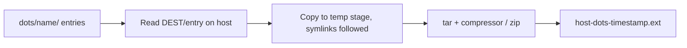

# export

## Synopsis

```bash
./export [options] [dot ...]
```

Exports the **live files of this host** (not the repo copies). Nothing on the host is modified. Without arguments it opens the same interactive menu as `import`, then asks for a format and level.

## Options

| Option               | Description                                                        |
| -------------------- | ------------------------------------------------------------------ |
| `-a`, `--all`        | Export every dot                                                   |
| `-f`, `--format FMT` | `tar`, `gz`, `bz2`, `xz`, `zst` or `zip` (default: asks, else `gz`) |
| `-l`, `--level N`    | Compression level (1-9, zstd up to 19); tool default if omitted    |
| `-o`, `--output FILE`| Output path (default `./host-dots-<timestamp>.<ext>`)              |
| `-r`, `--to-repo`    | Sync host files into `dots/<name>/` instead of making an archive   |
| `-L`, `--list`       | List available dots and exit                                       |
| `-n`, `--dry-run`    | Show what would happen, change nothing                             |
| `-y`, `--yes`        | Skip confirmation                                                  |
| `-h`, `--help`       | Show help                                                          |

## Archive Mode



- Each entry of `dots/<name>/` names a file to read from the dot's `DEST` (for example `~/.config/nvim/init.lua`).
- Missing host files are skipped with a warning; a dot with nothing on the host is skipped.
- A dot's `export` hook (`dot_export`) replaces the default copy, e.g. `gnome` runs `dconf dump`.
- The archive has one top-level folder per dot plus its `dot.conf`, `import` and `export` files, so it extracts straight into `dots/`.
- The temporary stage is removed on exit.

## Sync Mode (--to-repo)

Copies the live host files back into `dots/<name>/` so they can be reviewed and committed.

- The old repo copies are first moved to `~/.dot-files-backup/<timestamp>/`.
- Entries that are symlinks to the repo are skipped (already the repo copy).
- Repo entries containing `{{VAR}}` templates are **never overwritten** (a warning asks for a manual edit).
- Only entries already present in `dots/<name>/` are synced; new host files are not discovered.
- `-f`, `-l` and `-o` are ignored.

## Formats

| `-f`  | Extension | Requires | Notes                          |
| ----- | --------- | -------- | ------------------------------ |
| `tar` | `.tar`    | `tar`    | No compression                 |
| `gz`  | `.tar.gz` | `gzip`   | Fast, universal (default)      |
| `bz2` | `.tar.bz2`| `bzip2`  | Smaller, slower                |
| `xz`  | `.tar.xz` | `xz`     | Smallest common, slow          |
| `zst` | `.tar.zst`| `zstd`   | Fast and small                 |
| `zip` | `.zip`    | `zip`    | Windows-friendly               |

A missing compressor aborts with `Required tool not installed: <tool>`.

## Exit Status

| Code | Meaning                                                              |
| ---- | -------------------------------------------------------------------- |
| `0`  | Finished, or nothing to export                                       |
| `1`  | Bad option, unknown dot or format, invalid level, missing tool/library |

## Examples

```bash
./export                              # menu + prompts
./export -a -f zst -l 19              # everything, max zstd
./export nvim git -o ~/bk.tar.xz -f xz
./export -n -a                        # dry-run
./export -r nvim git                  # host -> dots/, then git diff
```

> **Warning:** host configs may contain credentials or history (`.aws`, `.git-credentials`, `.bash_history`). Keep archives private.
