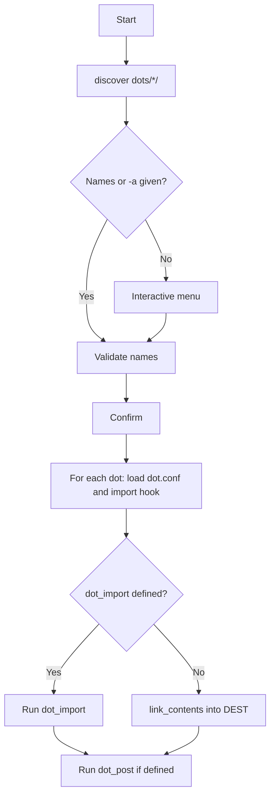

# import

## Synopsis

```bash
./import [options] [dot ...]
```

Installs dots from `dots/` onto the host (repo → system). Without arguments it opens an interactive menu.

## Options

| Option            | Description                                                        |
| ----------------- | ------------------------------------------------------------------ |
| `-a`, `--all`     | Import every dot                                                   |
| `-l`, `--list`    | List available dots and exit                                       |
| `-n`, `--dry-run` | Show what would happen, change nothing (no prompts)                |
| `-y`, `--yes`     | Skip confirmation; template placeholders use their defaults        |
| `-s`, `--set N=V` | Preset template variable `N` (uppercase name); repeatable          |
| `--no-template`   | Never render `{{VAR}}` placeholders; always symlink                |
| `-h`, `--help`    | Show help                                                          |
| `dot ...`         | Names of dots to import (skips the menu)                           |

## Behavior



1. Dots are discovered from `dots/*/`; each directory is one dot.
2. `dot.conf` supplies `DESC`, `DEST` (default `$HOME`) and `TEMPLATE`.
3. By default every entry of the dot (except `dot.conf`, `import`, `export`) is placed into `DEST`: symlinked, or rendered if it contains placeholders.
4. Empty dots are skipped with a warning.
5. A failing dot is reported (`<dot> failed.`) and the next one still runs.

## Template Mode

Files containing `{{NAME}}` or `{{NAME:default}}` (`NAME` matches `[A-Z][A-Z0-9_]*`) are copied with each placeholder replaced; the repo file is never modified.

Value resolution order:

1. Already known (`-s NAME=VALUE`, or answered earlier in the run)
2. Dry-run: a `<NAME>` placeholder, no prompt
3. `-y` or no TTY: the placeholder's default; without one the entry fails
4. Interactive prompt (silent input if the name contains `PASS`, `TOKEN`, `SECRET` or `KEY`)

Rendered targets that already match are left untouched (`Already up to date`).

## Backups

Anything that would be replaced is moved, never deleted, to:

```text
~/.dot-files-backup/<YYYYMMDD-HHMMSS>/<original absolute path>
```

Correct symlinks and identical rendered files are skipped, so re-running is safe.

## Exit Status

| Code | Meaning                                              |
| ---- | ---------------------------------------------------- |
| `0`  | Finished (individual dots may still report failures) |
| `1`  | Bad option, unknown dot, missing library, or no TTY for the menu |

## Examples

```bash
./import                                  # interactive menu
./import -a                               # every dot
./import nvim git                         # selected dots
./import -n -a                            # dry-run everything
./import git -s GIT_EMAIL=me@x.io -y      # scripted, no prompts
./import --no-template git                # plain symlinks
```
