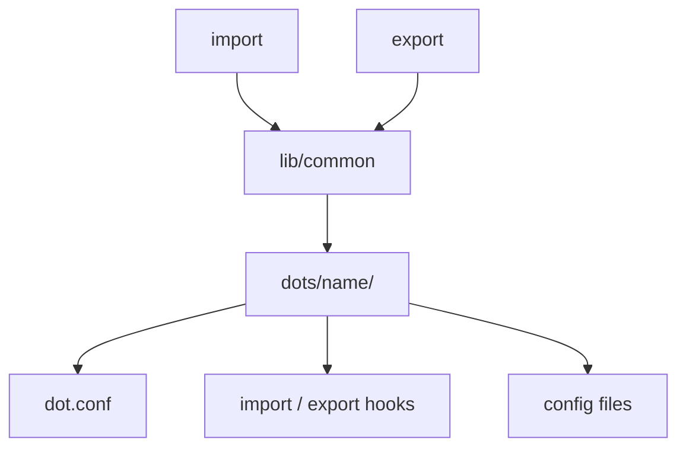
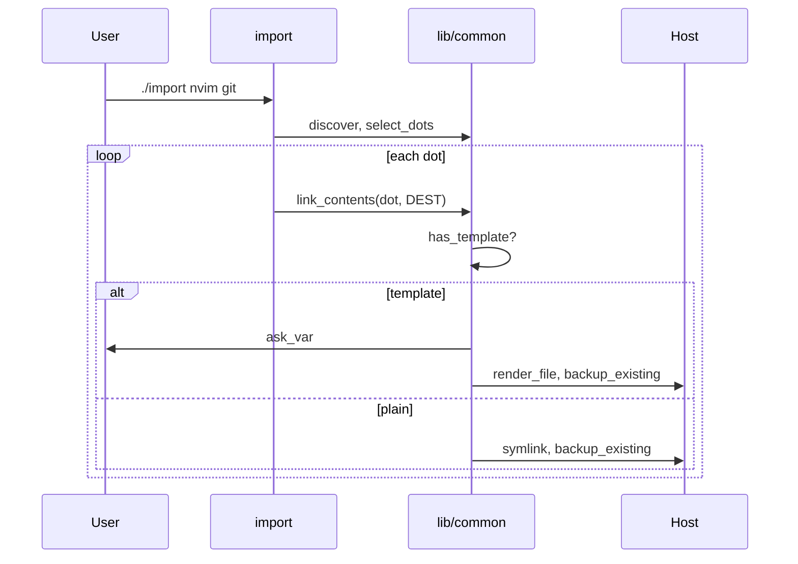
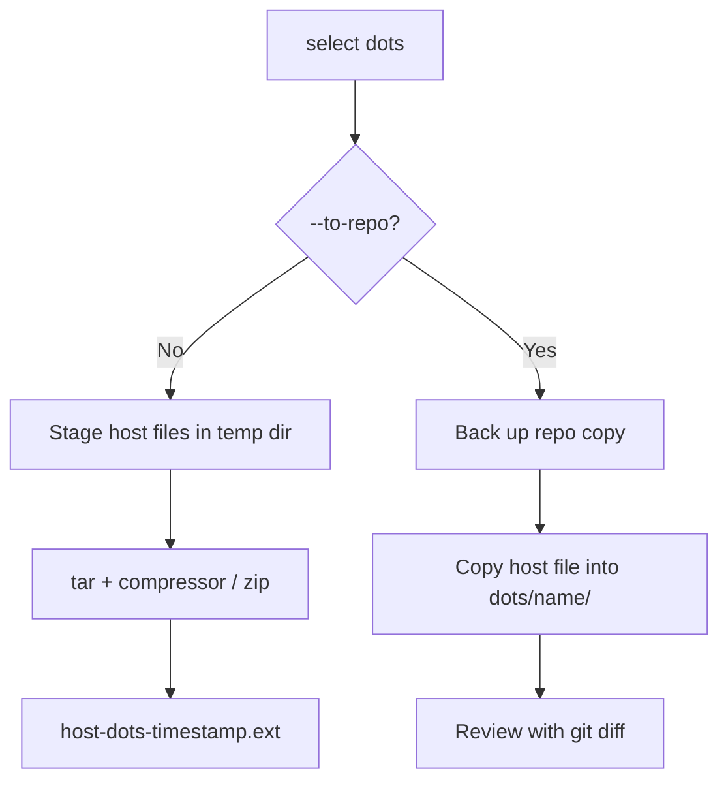

# Architecture

<!--toc:start-->

- [Architecture](#architecture)
  - [Repository Layout](#repository-layout)
  - [Components](#components)
  - [Import Flow](#import-flow)
  - [Export Flow](#export-flow)
  - [Design Principles](#design-principles)

<!--toc:end-->

## Repository Layout



```text
.
├── import          # repo -> system
├── export          # system -> archive / repo
├── lib/common      # shared functions and variables
├── dots/<name>/    # one directory per dot
├── docapi/         # API reference
└── res/            # images and documentation
```

## Components

| Component      | Responsibility                                                     |
| -------------- | ------------------------------------------------------------------ |
| `import`       | CLI: select dots, then link or render them into `DEST`             |
| `export`       | CLI: collect live host files into an archive or back into `dots/`  |
| `lib/common`   | Logging, backups, symlinks, templates, dot discovery and selection |
| `dots/<name>/` | Config files plus optional `dot.conf` and hooks                    |
| Hooks          | `dot_import`, `dot_post`, `dot_export` for non-file configs        |

## Import Flow



## Export Flow



## Design Principles

- Convention over configuration: a directory is a dot; no registry to maintain.
- Non-destructive: replaced files are always backed up, never deleted.
- Idempotent: running a command twice changes nothing the second time.
- Safe previews: `--dry-run` everywhere, with no prompts.
- Extensible through small, documented hooks.
- Shell-lint clean (`shellcheck -x`) and every function documented in its source.
