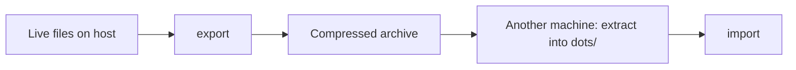

# Usage

<!--toc:start-->

- [Usage](#usage)
  - [Commands](#commands)
  - [Importing Dots](#importing-dots)
  - [Templates](#templates)
  - [Exporting Your Host](#exporting-your-host)
  - [Syncing Host to Repo](#syncing-host-to-repo)
  - [Adding a Dot](#adding-a-dot)

<!--toc:end-->

## Commands

| Command       | Direction        | Purpose                                          |
| ------------- | ---------------- | ------------------------------------------------ |
| `./import`    | repo → system    | Install dots (symlink or render templates)       |
| `./export`    | system → archive | Pack your live configs into a compressed archive |
| `./export -r` | system → repo    | Refresh `dots/` from your live configs           |

Both are interactive when run without arguments. See the [API reference](../../docapi/README.md) for every option.

## Importing Dots

```bash
./import                 # menu: numbers, names, 'a' = all, 'q' = quit
./import nvim git        # specific dots
./import -n -a           # dry-run
```

Existing files are moved to `~/.dot-files-backup/<timestamp>/` first and never overwritten.

## Templates

A file containing `{{NAME}}` or `{{NAME:default}}` is rendered instead of symlinked:

```ini
# dots/git/.gitconfig
[user]
    name  = {{GIT_NAME:Omar}}
    email = {{GIT_EMAIL}}
```

```bash
./import git                           # prompts for the values
./import git -s GIT_EMAIL=me@x.io -y   # scripted
./import --no-template git             # ignore placeholders
```

Secrets (`*PASS*`, `*TOKEN*`, `*SECRET*`, `*KEY*`) are typed silently.

## Exporting Your Host

```bash
./export                          # menu + format and level prompts
./export -a -f zst -l 19          # everything, zstd level 19
./export nvim git -o ~/bk.tar.xz -f xz
```



Archives can contain credentials. Keep them private.

## Syncing Host to Repo

```bash
./export -r nvim git
git diff
git commit -am "feat(nvim): update config"
```

Old repo copies are backed up, symlinked entries are skipped, and templated files are never overwritten.

## Adding a Dot

```bash
mkdir dots/mytool && cp ~/.config/mytool/* dots/mytool/
echo 'DEST="$HOME/.config/mytool"' > dots/mytool/dot.conf
./import -n mytool
```

See the [dot specification](../../docapi/DOT-SPEC.md).
